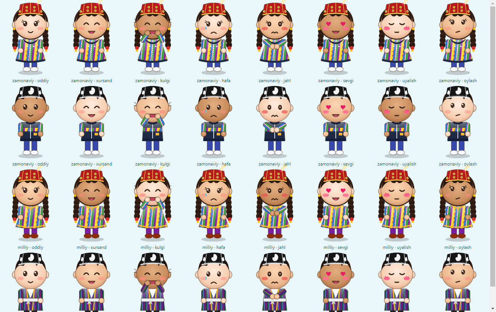
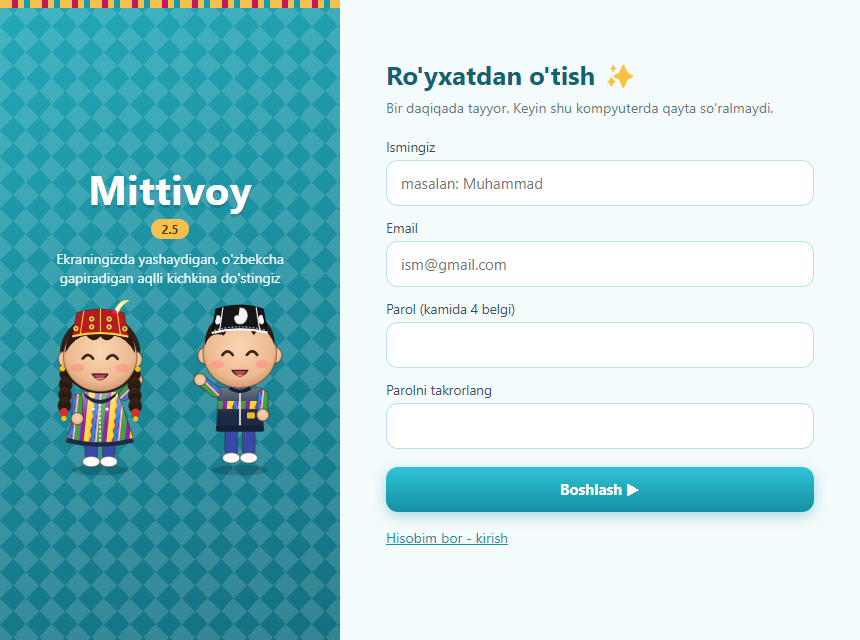

<p align="center"></p>

# Mittivoy 2.8.0 🇺🇿

**O'zbekcha AI yordamchi — ekraningizda yashaydigan kichkina do'st (Windows uchun)**

Mittivoy — milliy kiyimdagi kichkina qizaloq yoki bolakay. U ekraningizda sayr qiladi, oynalar ustiga chiqib o'tiradi,
o'ynaydi, his-tuyg'ulari va fe'li bor, siz bilan **o'zbek tilida** gaplashadi va kompyuterda ishlaringizni bajaradi.



## ⬇️ Yuklab olish

**[Mittivoy-2.8.0-Windows.zip ni yuklab olish](https://github.com/shokrirov1013/Mittivoy/releases/latest)**

1. ZIP'ni o'ng tugma bilan bosing → **Extract All** (Hammasini chiqarish).
2. `Mittivoy` papkasidagi **Mittivoy.exe** ni ikki marta bosing → **O'rnatish**.
   Windows ogohlantirsa: **More info → Run anyway**.
3. Ro'yxatdan o'ting — tayyor! Windows yoqilganda o'zi fonda ishga tushadi.

## ✨ Imkoniyatlar

| | |
|---|---|
| 🎵 **Qo'shiq qo'yish** | "Yulduz Usmonovaning qo'shig'ini qo'y" — YouTube'dan topib o'zi qo'yadi |
| 🌤 **Ob-havo** | "Samarqand ob-havosi qanday?" |
| 💱 **Valyuta kursi** | "Dollar kursi", "100 dollar necha so'm" (Markaziy bank) |
| 🧮 **Kalkulyator** | "125*48 nechchi?" |
| 🚀 **Dastur ochish** | "Telegramni och", "YouTube och" — imlo xatolarini ham tushunadi |
| ⏰ **Eslatmalar** | "10 daqiqadan keyin choy ichishni eslat" |
| 🧠 **Xotira** | Siz haqingizdagi muhim narsalarni eslab qoladi |
| 🤖 **Aqlli rejim** | Oddiy suhbat — Gemini (tez, bepul), murakkab ishlar — Claude (kompyuterni boshqaradi) |
| 🪟 **Oynalar ustida** | Oynalarga chiqib yuradi, oynadan oynaga sakraydi, chetida o'tiradi, oyna bilan birga yuradi; ko'tarib oyna ustiga tashlasangiz — o'sha yerga qo'nadi |
| 🆓 **Hamma uchun bepul** | Hisob, kalit yoki to'lovsiz ishlaydi; limiti tugagan server o'zi chetlab o'tiladi (Gemini → Groq → kalitsiz bepul server), Claude esa faqat ixtiyoriy qo'shimcha |
| 🤫 **Fonda ishlaydi** | Buyurgan ishlaringiz oynangizni egallamasdan bajariladi; qo'shiq ko'rinmas pleyerda chalinadi |
| 🔑 **API kalitlar** | Sozlamalarda Gemini, Groq va Claude uchun alohida qator: "Qo'yish" → "Tekshirish" → ishlayapti / ishlamayapti (sababi bilan) |
| 🔄 **Avtomatik yangilanish** | Yangi versiya GitHub'ga chiqishi bilan ilovaning o'zi yuklab olib o'rnatadi |
| 🎮 **O'yinlar** | To'p, sovun pufaklari, quvlashmachoq, raqs, umbaloq |
| 💕 **Fe'l-atvor** | So'ksangiz arazlaydi, kuldirsangiz kuladi, maqtasangiz uyaladi |
| 👤 **Hisoblar (serverda)** | Email bilan kirish, parolni email orqali tiklash; istalgan kompyuterda o'z qahramoningiz va xotirangiz |

Yuqoridagi tezkor ishlarning barchasi **bepul** va AI serversiz darhol bajariladi.



## 🛠 Manba kodidan yig'ish

Ilova [Electron](https://www.electronjs.org/) asosida: `app/` papkasi — ilova kodi, `scripts/build-app.ps1` — tayyor ZIP yig'uvchi skript.

```powershell
powershell -ExecutionPolicy Bypass -File scripts\build-app.ps1 -Src .
```

Rasmiy Electron dvigateli o'zgartirilmagan holda ishlatiladi, shuning uchun Windows Smart App Control yoqilgan kompyuterlarda ham ishlaydi.

## 🔒 Maxfiylik

Hisob, sozlamalar va xotira Supabase serverida saqlanadi; har bir foydalanuvchi faqat o'z yozuvini ko'radi (Row Level Security).
Gemini/Groq/Claude kalitlari serverga faqat parolingizdan olingan kalit bilan shifrlangan holda yuboriladi. Shu kompyuterdagi sessiya Windows DPAPI bilan shifrlanadi.
